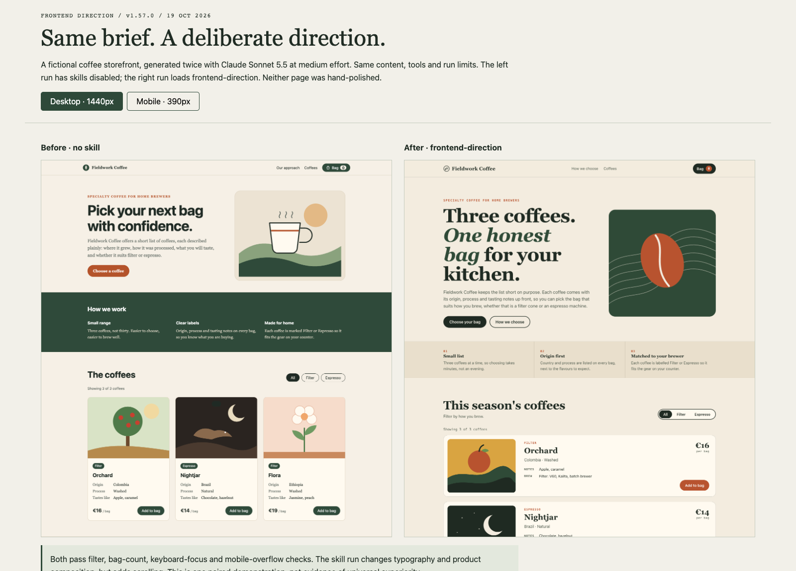

# Frontend direction evaluation

Date: 2026-10-19. This evaluation tests the released v1.57.0 skill. The pre-code checkpoint added in the current PR has not yet been behaviorally re-tested.

## Runtime results

| Agent | Skill discovery | Frontend build | Direction and component choices before first UI edit | Small UI fix |
| --- | --- | --- | --- | --- |
| Codex | Passed; transcript read installed skill | Passed | Passed | Passed; changed only the requested 8px to 12px spacing |
| Claude Code | Passed; skill invoked | Passed | Not demonstrated; direction was reported after first UI edit | Passed; changed only the requested 8px to 12px spacing |
| Pi | Passed; native loader found the skill | Deferred; no authenticated provider | Unknown | Deferred |
| Hermes | Passed; native skill index found the skill | Deferred; no connected provider | Unknown | Deferred |

Pi and Hermes model trials were explicitly deferred pending provider authentication. Their discovery checks do not establish behavior during a model run.

## Controlled comparison

The paired pages use the same fictional coffee storefront brief, content, tool permissions, model (`claude-sonnet-5-5`), medium effort, and run limits. The intended difference is skill availability. Neither generated page was hand-polished.

Both pages passed browser checks for filtering, bag count, keyboard focus, and 390px mobile overflow. The skill-assisted page uses a more editorial composition and horizontal coffee rows, with additional scrolling. This is one paired demonstration, not a benchmark or evidence that the treatment is universally better; no blinded human preference test was run.

The self-contained brief used no external assets or dependencies. This does not validate integration with an existing component library. Raw model transcripts are not included in the repository.

## Follow-up validation

- Re-run Claude against the updated skill and verify the required decision record appears before the first UI edit. An attempted rerun after this edit stopped immediately: the local Claude CLI returned `Not logged in` before generating a response or consuming model tokens.
- Run authenticated Pi and Hermes trials when providers are available.
- Repeat with a project that already uses a component library to assess source selection and compatibility.
