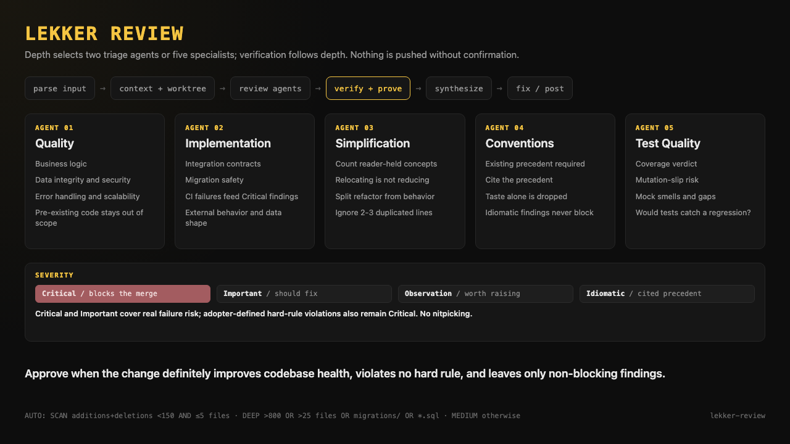
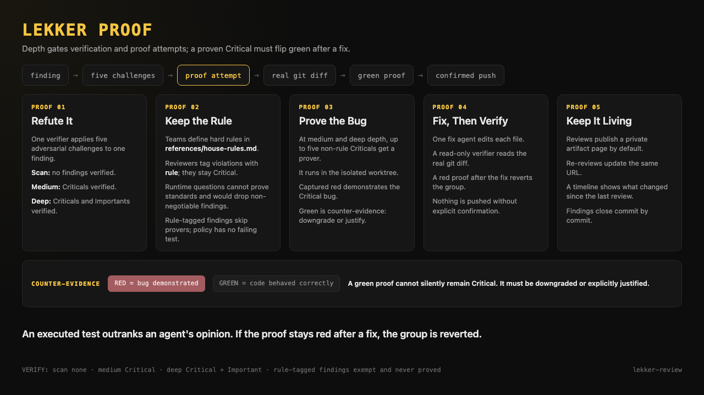

# lekker-review

FAANG-quality PR code review for GitHub. It gathers the context a human reviewer
would gather and checks the branch out into an isolated worktree when the depth
requires one. `scan` runs two triage agents plus project-rules. `medium` and
`deep` run five specialists plus project-rules and attempt proofs for at most five non-rule
Critical findings.



## Why it is not a checklist reviewer

Most review tooling reports whatever the model believed on its first pass.
This skill spends most of its budget trying to disprove itself.



- **Adversarial verification.** Every Critical and Important is checked at
  every depth because either can affect the verdict. Runtime findings use the
  verifier's five-challenge refutation.
- **Proof of bug.** In `medium` and `deep`, up to five non-rule Criticals are
  sent to prover agents that attempt to write and run a failing test. A proof
  that comes back green is counter-evidence: the workflow automatically
  downgrades the finding from Critical to Important.
- **Hard-rule validation.** A finding tagged with a `rule` keeps Critical
  severity only after the verifier confirms its diff anchor and rule
  applicability. It skips only the runtime-failure challenges.
- **Fix mode.** `--fix` has one agent edit each file, a read-only verifier read
  the real `git diff`, and the captured proof re-run. If the proof stays red the
  group is reverted. Nothing is pushed without explicit confirmation.

## Models and effort

The model is not the main lever: a reviewer finds more when it spends effort
checking callers, tests, error paths and assumptions. So each agent's effort
rises with the PR's risk first, and the model grows only for risky changes.
Not every agent gets the same tier: the agents that find issues stay one step
below the verifier, because the verifier decides what survives. Haiku and Luna
only ever do a cheap first pass, never the final check.

Each host uses its own vendor's models: Claude Code runs Claude models, Codex
runs Codex models. Cells read `Claude / Codex`.

| Agent | routine | standard | elevated | critical |
| --- | --- | --- | --- | --- |
| Triage (scan depth, first pass only) | Haiku medium / Luna medium | Haiku medium / Luna medium | Haiku medium / Luna medium | Haiku medium / Luna medium |
| Specialists x5 (quality, implementation, simplification, conventions, test-quality) | Sonnet medium / Sol medium | Sonnet high / Sol high | Opus high / Astra high | Opus xhigh / Astra xhigh |
| Project rules, deps checklist | Sonnet medium / Sol medium | Sonnet medium / Sol medium | Sonnet high / Sol high | Sonnet high / Sol high |
| Verifier, critic re-examine, fix verifier | Sonnet high / Sol high | Sonnet high / Sol high | Opus high / Astra high | Fable high / Astra high |
| Completeness critic (deep) | Sonnet medium / Sol medium | Sonnet high / Sol high | Opus high / Astra high | Fable xhigh / Astra xhigh |
| Prover (writes the failing test) | Sonnet high / Sol high | Sonnet high / Sol high | Sonnet high / Sol high | Opus high / Astra high |
| Fixer (--fix) | Sonnet high / Sol high | Sonnet high / Sol high | Sonnet high / Sol high | Opus high / Astra high |
| Comment polish (--post) | Sonnet medium / Sol medium | Sonnet medium / Sol medium | Sonnet medium / Sol medium | Sonnet medium / Sol medium |
| Housekeeping | Haiku low / Luna low | Haiku low / Luna low | Haiku low / Luna low | Haiku low / Luna low |

The risk tier is picked from the changed files, and `--risk <tier>` overrides it:

| Tier | When |
| --- | --- |
| routine | every changed file is documentation (`*.md`, `*.mdx`, `*.txt`, `*.rst`, `docs/`, `LICENSE`) |
| standard | everything else |
| elevated | CI workflows or installers, migrations or `*.sql`, or more than 800 changed lines or 25 files |
| critical | auth or billing paths |

Depth and tier are separate: depth decides how many agents run, the tier
decides how strong each one is. A UI-only diff runs the Codex specialists on
Terra high, the Codex model positioned for visual reasoning. The main loop
(context gathering and the final write-up) runs on your session model. The
table is generated from `scripts/model-matrix.mjs`; a test fails if they drift.

## Comment voice

With `--post`, inline comments follow `references/comment-voice.md`: the ask,
then why it matters in plain words, then the fix. One agent rewrites the drafts
for readability, and `scripts/comment-facts.mjs` reverts any comment whose
code names, file references, numbers, links, suggestion blocks, negations or
will/may/must wording changed. The voice rules are
adapted from [Clarity](https://github.com/addyosmani/clarity) by Addy Osmani
(MIT). Clarity is optional: when it is installed
(`npx skills add addyosmani/clarity`), the rewrite also uses its editing guide.

## Requirements

Claude Code or OpenAI Codex, plus `git` and an authenticated `gh`. Claude uses
Workflow/Agent and can publish the living page with Artifact. Codex uses native
collaboration agents and keeps the same review/verify/critic/prove/fix gates; if
no publish-capable artifact tool is available, it updates a stable local HTML
artifact under `~/code-reviews/artifacts/`.

## Setup

`references/house-rules.md` ships as a template. Replace its example rules with
your team's own non-negotiables, the ones that should always be Critical
regardless of review depth. The skill has no hard rules of its own: everything
blocking comes from that file.

## Usage

```text
lekker-review https://github.com/owner/repo/pull/123
lekker-review owner/repo 123 deep --post
lekker-review owner/repo 123 --fix
```

Depth is auto-selected from the diff size when you do not name one: `scan` under
150 changed lines and 5 files, `deep` over 800 changed lines or 25 files or when
the diff touches migrations or `*.sql`, `medium` otherwise.

## Regenerating the posters

The posters are self-contained HTML in `assets/`. Open either file in a browser
at a 1280x720 viewport and screenshot it to regenerate the PNG.

## Pre-push review label

Branch-mode reviews can apply `reviewed-before-push` after pushing and opening
or locating the PR. A comment records the reviewed commit, engine, depth, and
result; unresolved Critical/Important findings prevent labeling. Install the
[cleanup workflow](references/reviewed-before-push.yml) on the target repo's
default branch first so new, unreviewed commits lose the label. See the
[receipt and setup procedure](references/reviewed-before-push.md). This label
provides visibility and does not replace required remote review or CI.
